<div align="center">


<a href="https://richardesley-dev.vercel.app/"></a>&nbsp;
<a href="https://www.linkedin.com/in/richardesley"></a>&nbsp;
<a href="mailto:richardesleyso@gmail.com"></a>


</div>

---

## `> whoami`

```bash
richard@github:~$ whoami

Name        Richard Esley
Role        Full Stack Developer
Work        Freelance Full Stack Developer @ Fate Eight Tech
Location    Brasília, Brazil
Education   B.Sc. Computer Science @ CEUB (graduating Dec 2026)

Focus       Product Development • Full Stack Engineering • UI/UX • Automation
Building    Evolyn Core Quest — gamified personal evolution ecosystem
Creative    Lost Sky Dragon — original game & book project

Stack       React • Next.js • TypeScript • Node.js • Python
Data        PostgreSQL • Supabase • MongoDB
Infra       Docker • AWS • GitHub Actions • Vercel
Quality     Vitest • Playwright • CI/CD

Status      Open to Junior / Internship Software Engineering roles
Fun Fact    Violinist & Violist 🎻
```

<div align="center">
  
</div>

<div align="center">

I build complete digital products — from the first interface to backend architecture, database, deployment and continuous improvement.

**Software should solve real problems, feel intuitive and be built to evolve.**

</div>

---

## `> ls ./featured-work`

<table>
<tr>
<td width="50%" valign="top">

### 🎮 Evolyn Core Quest

**Gamified personal evolution ecosystem**

A mobile-first platform combining training, routines, XP, streaks, rankings, reminders and progression mechanics into one connected experience. Ships as a PWA with push notifications, and uses Capacitor for Android and iOS.

`TypeScript` `React` `Vite` `Supabase` `PWA` `Capacitor`

<a href="https://evolyn-core-quest.vercel.app/">Open Live App →</a><br/>

</td>
<td width="50%" valign="top">

### 🐔 Granja Mult Core

**Production management platform**

Full-stack management system for poultry operations: batches, inventory, expenses, users, permissions, dashboards and financial analysis. I was the technical lead of a 5-person team, working with Scrum and CI/CD.

`React` `Node.js` `Supabase` `RBAC` `CI/CD`

<a href="https://granjamultcore.com.br/">granjamultcore.com.br →</a>

</td>
</tr>

<tr>
<td width="50%" valign="top">

### 💰 Fate Light

**Operations & financial management for freelancers**

A lightweight workspace for managing clients, one-time, installment and recurring billing, expenses and domain renewals, with alerts, without relying on scattered spreadsheets. Tested with Vitest and Playwright, with CI on GitHub Actions.

`Next.js` `TypeScript` `Tailwind` `Supabase` `Vitest` `Playwright`

<a href="https://fatelight-alpha.vercel.app/">Open Live App →  </a> or
<a href="https://github.com/RDEsley/Fate-Light">Explore repository →  </a>

</td>
<td width="50%" valign="top">

### 🧠 InstaAnalytics

**Social analytics + intelligent processing**

Automated analysis of Instagram profiles using machine learning and web scraping, connecting a React frontend to a Node.js backend. Built with a 3-person team that I led. It was my first academic project.

`React` `Node.js` `Python` `Machine Learning` `Web Scraping`

<a href="https://github.com/RDEsley/InstaAnalytics">Explore repository →</a>

</td>
</tr>
</table>

<div align="center">

<a href="https://github.com/RDEsley?tab=repositories"></a>

</div>

---

## `> cat stack.json`

<div align="center">

### Core


### Data


### Infrastructure & Tools


</div>

---

## `> cat principles.txt`

```text
01. Build software that solves a real problem

02. UX is part of engineering

03. Keep systems understandable

04. Ship → learn → improve

05. Good architecture should make change easier

06. Code is part of the product — not the product itself
```

---

## `> git log --milestones`

```text
2026  🎓  Finishing Computer Science at CEUB (Dec 2026)
2026  🐉  Creating Lost Sky Dragon — original game & book
2026  🚀  Building Evolyn Core Quest
2026  💰  Shipped Fate Light
2026  🐔  Shipped Granja Mult Core
2025  💼  Started working as a freelance Full Stack Developer
2026  🌐  Built distributed systems projects
2025  📸  Developed InstaAnalytics
2025  🤖  Worked on SASens AI
2024  🎓  Completed Technical Degree in IT
```

---

## `> github --analytics`

<br/>

<div align="center">


<br/><br/>



</div>

---

## `> contact --open`

<div align="center">

### 🟢 Open to Software Engineering opportunities

**Full Stack Development · Frontend · UI/UX · Backend · Junior Software Engineering · Internship**

<br/>

<a href="https://richardesley-dev.vercel.app/"></a>&nbsp;
<a href="https://www.linkedin.com/in/richardesley"></a>&nbsp;
<a href="mailto:richardesleyso@gmail.com"></a>

<br/><br/>

[](https://github.com/RDEsley)
[](https://hits.sh/github.com/RDEsley/)

</div>

---

<div align="center">


<sub>"Confie no Senhor de todo o seu coração e não se apoie em seu próprio entendimento." – Provérbios 3:5</sub>

</div>
